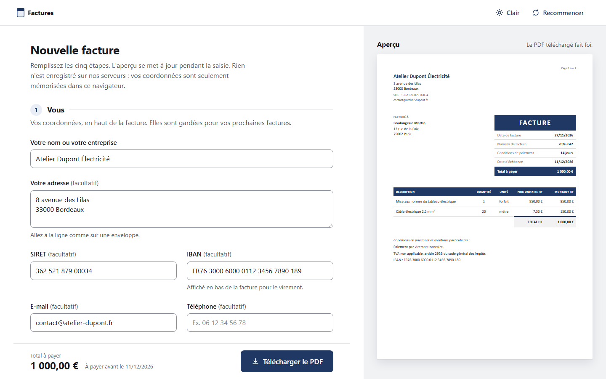
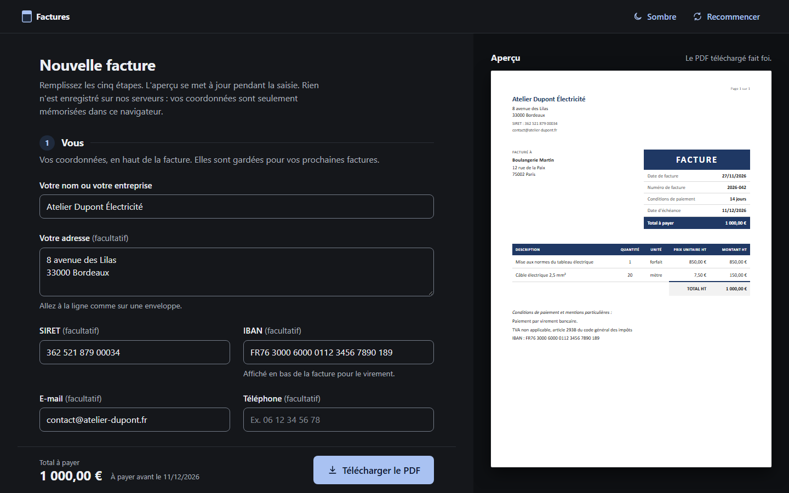
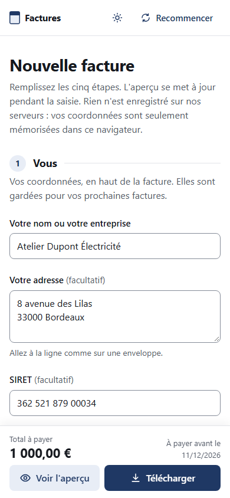
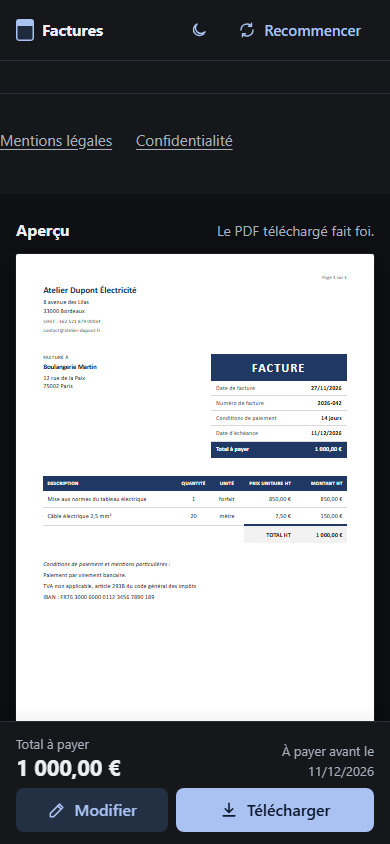
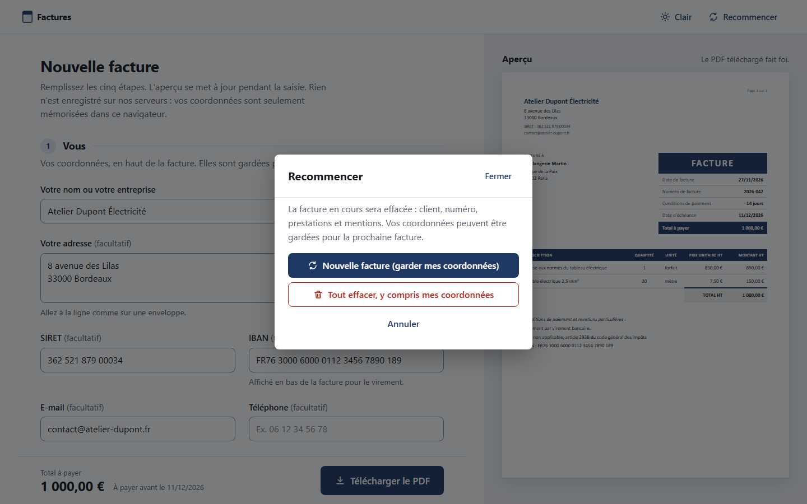
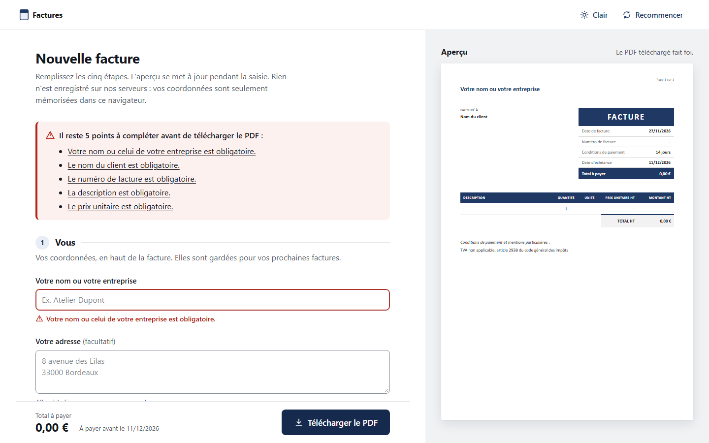
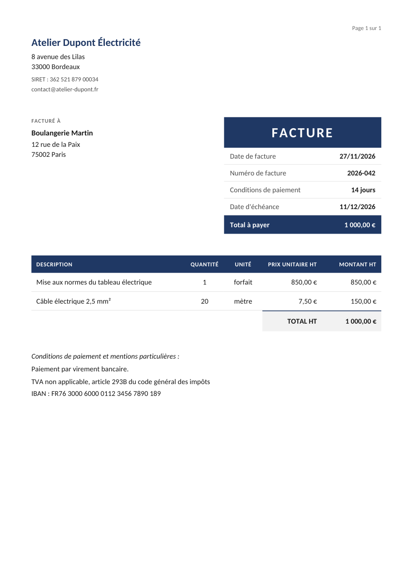

# invoice-pdf

[](https://github.com/GomuGomuNo01/invoice-pdf/actions/workflows/ci.yml)
[](https://github.com/GomuGomuNo01/invoice-pdf/actions/workflows/surveillance.yml)
[](LICENSE)

Application web pour faire ses factures en quelques minutes : on remplit un formulaire simple, l'aperçu se met à jour en direct, et on télécharge un PDF propre au format A4.

**En ligne : https://invoice-pdf-hxrd.onrender.com**



## Fonctionnalités

- **Formulaire en cinq étapes** : vous, le client, la facture, les prestations, les mentions.
- **Aperçu en direct**, fidèle au PDF, et calcul immédiat des montants, du total et de l'échéance.
- **PDF généré par le serveur** : montants en décimal exact (arrondi au centime), pagination « Page X sur Y », en-tête du tableau répété sur chaque page, police embarquée.
- **Mise en forme de facture classique** : libellés à gauche, montants à droite, prix unitaire et montant HT, mention « TVA non applicable, article 293B du code général des impôts ».
- **Vos coordonnées sont mémorisées** dans votre navigateur pour les factures suivantes, jamais sur le serveur.
- **Thème clair, sombre ou automatique** : par défaut, celui de l'appareil (ordinateur, téléphone).
- **Pensé pour le mobile** : saisie et aperçu séparés, barre d'action toujours visible.
- **Accessible** : navigation au clavier, messages d'erreur reliés aux champs, contrastes vérifiés (WCAG AA).
- **Aucune donnée conservée** : pas de compte, pas de base de données, pas de cookie, pas de mesure d'audience.

| Thème sombre | Sur téléphone | Aperçu sur téléphone |
|---|---|---|
|  |  |  |

| Recommencer | Erreurs de saisie | PDF obtenu |
|---|---|---|
|  |  |  |

Exemple de PDF : [captures/facture-exemple.pdf](captures/facture-exemple.pdf). Les captures utilisent des données fictives et se regénèrent avec `npm run captures` (dossier `frontend`).

## Architecture

```
Navigateur (React)  --HTTPS-->  Render (Cloudflare)  -->  Spring Boot
  formulaire, aperçu,                                      - sert l'interface
  calcul en direct,                                        - valide la facture
  thème, coordonnées                                       - calcule les montants
  mémorisées                                               - fabrique le PDF (Thymeleaf + OpenHTMLToPDF)
```

| Partie | Technologies |
|---|---|
| Backend | Java 21, Spring Boot 4.2, Thymeleaf, OpenHTMLToPDF (PDFBox 3), springdoc |
| Frontend | React 19, TypeScript 5.9, Vite 8, Zod 4, Vitest, Playwright, axe |
| Police du PDF | Carlito (licence OFL, métriquement compatible avec Calibri), embarquée |
| Hébergement | Render (offre gratuite, Francfort), image Docker unique |
| Intégration continue | GitHub Actions, Dependabot, gitleaks |

## Démarrage local

Prérequis : Java 21 et Node 24. Maven est fourni par le wrapper (`mvnw`).

1. Activer les garde-fous Git (une fois par clone) :
   ```
   git config core.hooksPath .githooks
   ```
2. Facultatif : copier `.env.example` en `.env` pour préremplir l'émetteur (fichier jamais versionné, lu en UTF-8).
3. Backend (port 8080) :
   ```
   cd backend
   ./mvnw spring-boot:run
   ```
   Sous Windows : `.\mvnw.cmd spring-boot:run`.
4. Frontend (port 5173, appels `/api` relayés vers le backend) :
   ```
   cd frontend
   npm install
   npm run dev
   ```

Ouvrir http://localhost:5173. Documentation de l'API en local : http://localhost:8080/api/docs (désactivée en production).

Avec Docker : `docker compose up --build`, puis http://localhost:8081.

## Tests

```
cd backend && ./mvnw verify        # calculs, formats, API, PDF (contenu, pagination), sécurité, anti-veille
cd frontend && npm test            # calculs exacts, validation, parcours, thème, Recommencer
cd frontend && npm run lint        # ESLint, dont l'accessibilité (jsx-a11y)
cd frontend && npm run test:e2e    # Playwright : parcours complet, accessibilité (axe), mobile, thème sombre
cd frontend && npm run captures    # regénère le dossier captures/
```

La CI exécute aussi trois essais Docker : la pile locale (nginx), la pile auto-hébergée (Caddy, HTTPS, accès restreint) et l'image unique dans les conditions de l'offre gratuite (512 Mo, lecture seule).

## Mise en ligne et exploitation

### Render (hébergement actuel)

Le `Dockerfile` à la racine construit une image unique : Spring Boot sert l'interface et l'API (profil `prod`, réglée pour 512 Mo). `render.yaml` décrit le service, et Render redéploie chaque nouveau commit de `main`.

| Besoin | Outil |
|---|---|
| Ce qui est en ligne | `GET /api/v1/version` (version et commit) |
| Vérifier le site | `sh scripts/verifier-en-ligne.sh https://invoice-pdf-hxrd.onrender.com [--limite]` |
| Après chaque fusion dans `main` | Workflow « Vérification après déploiement » : attend le commit en ligne, puis vérifie le site |
| Surveillance | Workflow « Surveillance du site » : santé toutes les 10 minutes, vérification complète le lundi, e-mail en cas d'échec |
| Éviter la mise en veille | L'application appelle sa santé publique toutes les 10 minutes (`INVOICE_KEEP_AWAKE_URL`) ; la surveillance GitHub la réveille si besoin |

L'offre gratuite de Render endort un service après 15 minutes sans visite et propose 750 heures par mois, de quoi garder un seul service éveillé en permanence.

### Auto-hébergement (serveur avec Caddy)

La pile `deploy/` place Caddy (HTTPS automatique, accès restreint facultatif, santé publique `/sante`) devant nginx et le backend. Les images se publient sur ghcr.io par étiquette de version sur `main` (workflow « Publication », avec SBOM et attestation de provenance). Détails : `deploy/.env.prod.example`, et `scripts/tester-prod.sh` pour l'essai complet.

## API

`POST /api/v1/invoices/pdf` (JSON) renvoie `application/pdf` en pièce jointe `Facture-<numéro>.pdf`.

```json
{
  "invoiceNumber": "2026-042",
  "invoiceDate": "2026-11-27",
  "paymentTermsDays": 14,
  "client": { "name": "Boulangerie Martin", "addressLines": ["12 rue de la Paix", "75002 Paris"] },
  "lines": [
    { "description": "Mise aux normes du tableau électrique", "quantity": 1, "unit": "forfait", "unitPrice": 850.00 }
  ],
  "notes": "Paiement par virement bancaire.",
  "issuer": {
    "name": "Atelier Dupont Électricité",
    "addressLines": ["8 avenue des Lilas", "33000 Bordeaux"],
    "siret": "362 521 879 00034",
    "email": null,
    "phone": null,
    "iban": null
  }
}
```

- Les montants, le total HT, le total à payer et la date d'échéance sont toujours calculés par le serveur ; tout champ inconnu est refusé.
- Le bloc `issuer` est facultatif : à défaut, l'émetteur de la configuration est utilisé.
- Erreurs au format `application/problem+json` (RFC 9457), avec la liste `errors` des champs invalides.
- Autres points d'accès : `GET /api/v1/issuer` (émetteur configuré), `GET /api/v1/site` (mentions légales), `GET /api/v1/version`, `GET /actuator/health`.

| Champ | Règle |
|---|---|
| Numéro | 1 à 30 caractères : lettres, chiffres, `-` `/` `_` `.` |
| Délai de paiement | 0 à 365 jours |
| Lignes | 1 à 100 |
| Quantité | strictement positive, 3 décimales au plus |
| Prix unitaire | positif ou nul, 2 décimales au plus |
| SIRET, IBAN, e-mail, téléphone | formats contrôlés |
| Textes | longueurs bornées, caractères de contrôle refusés |

## Sécurité

- Données saisies échappées dans le gabarit ; aucune ressource externe chargée pendant le rendu du PDF.
- Validation stricte côté serveur, corps limité à 256 Ko, 30 PDF par minute et par adresse réelle du visiteur, 2 à 4 rendus simultanés au maximum.
- En-têtes de sécurité (CSP stricte, HSTS, X-Frame-Options, nosniff), aucune trace d'erreur renvoyée au client.
- Aucun contenu de facture dans les journaux (identifiants techniques uniquement).
- Hook `pre-commit` et CI : refus des fichiers internes, des tirets longs et des secrets (gitleaks) ; alertes de vulnérabilités Dependabot actives.

## Organisation du dépôt

| Branche | Rôle |
|---|---|
| `dev` | Développement courant. Les mises à jour Dependabot y arrivent. |
| `main` | Version en ligne, protégée : pull request et CI verte obligatoires. |

Les branches de pull request sont temporaires et supprimées après fusion.

## Licence

MIT. La police Carlito est distribuée sous licence SIL Open Font License (`backend/src/main/resources/fonts/OFL.txt`).
